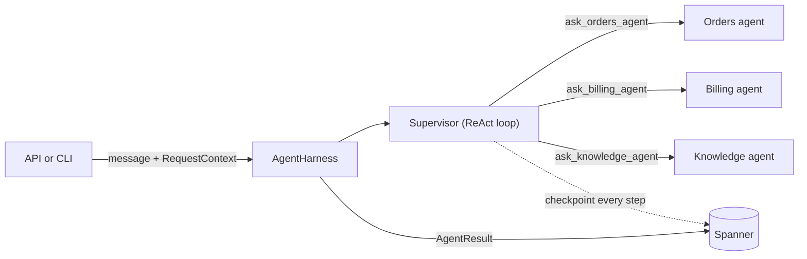

# helpdesk

A small reference codebase for a multi-agent service on LangChain 1.x and LangGraph, with
Cloud Spanner for checkpoints, long-term memory and final results.

The domain is a customer-support desk with four agents. A supervisor talks to the customer
and delegates to three specialists: orders, billing and the help center. The domain only
exists to make the structure concrete; swap it for yours.

## Layout

```
src/helpdesk/
  core/              building blocks, no domain code
    context.py       RequestContext: who we are serving (read-only, never checkpointed)
    state.py         HelpdeskState: what the ReAct loop carries and checkpoints
    spec.py          AgentSpec: what makes one agent unique. Agent: a built one
    factory.py       AgentFactory: turns a spec into a LangGraph agent
    registry.py      AgentRegistry: finds agents by name
    harness.py       AgentHarness: runs one turn and saves the result
    results.py       AgentResult and the ResultRepository interface
    memory.py        recall and remember, on top of the LangGraph store
    errors.py        RecoverableError and its subclasses
  middleware/        cross-cutting behaviour, assembled in one ordered list
  prompts/           one system prompt per agent, plus the context prompt
  agents/            one module per agent: its tools and its spec
  backends/          interfaces to company systems, plus demo implementations
  storage/           checkpointer, store and results: in-memory and Spanner
  bootstrap.py       composition root, the only place concrete classes are chosen
  settings.py        configuration from HELPDESK_* environment variables
  __main__.py        command-line entry point
tests/               scripted-model tests, and Spanner emulator tests
```

## How a request flows



1. The caller builds a `RequestContext` from the authenticated user and calls
   `harness.run(agent_name, message, context, thread_id=...)`.
2. The harness looks the agent up, sets the thread and run ids, and invokes it.
3. Every agent is a `create_agent` ReAct loop. Middleware wraps each model and tool call.
   Memories load once per turn, the context prompt is appended to the system prompt, and
   limits, retries and tool errors are handled in one place.
4. The specialists are offered to the supervisor as tools. Each runs its own ReAct loop
   and returns one answer.
5. LangGraph checkpoints state after every step. The harness saves the final
   `AgentResult`, including failed and escalated runs.

## Design

| Pattern | Where | Why |
| --- | --- | --- |
| Factory | `core/factory.py` | Every agent is built the same way. Model, storage and middleware are decided once. |
| Registry | `core/registry.py` | Callers choose an agent by name and never import agent modules. |
| Chain of responsibility | `middleware/` | Each concern is one small class, and their order is explicit in one list. |
| Strategy | `MiddlewarePolicy`, `Storage` | The middleware policy and the storage backend can change without touching agents. |
| Repository | `core/results.py` | The harness saves results without knowing about Spanner. |
| Adapter | `storage/spanner/` | Spanner sits behind LangGraph's own checkpointer and store interfaces. |
| Composition root | `bootstrap.py` | Concrete classes are chosen in one file; everything else receives its dependencies. |
| Supervisor with agents as tools | `agents/supervisor.py` | The multi-agent shape LangChain recommends for a router with specialists. |

How SOLID shows up:

- **Single responsibility.** An agent module describes one agent. Each middleware does one
  thing. The harness only runs turns.
- **Open/closed.** A new agent is a new module plus three lines in `bootstrap.py`. A new
  concern is a new entry in the middleware list.
- **Liskov substitution.** Spanner and in-memory storage are interchangeable. The same
  scenarios run against both in the tests.
- **Interface segregation.** Tools depend on small protocols such as `OrderSystem`, not on a
  large client.
- **Dependency inversion.** `core` defines `ResultRepository` and `storage` implements it.
  Nothing in `core` or `agents` imports Spanner or a concrete backend.

Conventions worth carrying over:

- Identity comes from `RequestContext`, never from tool arguments. Tools read
  `runtime.context.customer_id`, so the model cannot ask for another customer's data.
- Tools raise `RecoverableError` for expected failures such as an unknown id or a policy
  limit. The model sees the message and recovers. Any other exception fails the run, and
  the failure is recorded.
- State holds only what must be checkpointed. Per-request facts go in the context, and
  facts that outlive a thread go in the store.
- Prompts are files. The system prompt never changes per request, so it can be cached.
  Only the context prompt varies.
- Rules that must hold whatever the model does live in code, not in prompts. The billing
  system enforces refund limits, and `ToolCallLimitMiddleware` allows one refund per run.

## Running it

```bash
uv sync
cp .env.example .env        # then set ANTHROPIC_API_KEY
uv run python -m helpdesk "Where is my order A-1001?"
uv run python -m helpdesk -v                    # chat on one thread; -v logs model and tool calls
uv run python -m helpdesk --agent billing "Refund 20 dollars on INV-502"
```

In the demo data, customer `c-100` owns order A-1001 (shipped) and A-1002 (not shipped yet).
Refunds over 100 USD need human approval.

The default model is `claude-opus-5-5` at medium effort, with Anthropic's server-side
fallback turned on, so a declined request is retried on a fallback model. Change the model
in `bootstrap.build_model`; for Claude on Vertex AI, swap `ChatAnthropic` for the Vertex
chat model there and nothing else changes.

## Tests

```bash
uv run pytest               # no API key and no network needed
```

The tests drive the real wiring from `bootstrap.py` with a scripted chat model, so they
cover delegation, tool errors, limits, memory and checkpointing without calling an LLM.

To include the Spanner tests, start the emulator first:

```bash
docker run -d -p 9010:9010 gcr.io/cloud-spanner-emulator/emulator
SPANNER_EMULATOR_HOST=localhost:9010 uv run pytest
```

## Spanner

Apply `src/helpdesk/storage/spanner/schema.sql`, then set `HELPDESK_STORAGE=spanner` and the
three `HELPDESK_SPANNER_*` variables. One database holds four tables:

- `checkpoints` and `checkpoint_writes`: LangGraph's short-term state, one row per step.
- `store_items`: long-term memory, through the LangGraph store interface.
- `agent_results`: the final answer of every run.

There is no published Spanner checkpointer for LangGraph. The `langchain-google-spanner`
package ships chat history, vector and graph stores, but no checkpointer or LangGraph store.
So `storage/spanner/` contains three small adapters:

- `SpannerCheckpointer` stores each checkpoint as one blob, the way the SQLite saver does.
- `SpannerStore` supports get, put, delete and namespace search with exact-match filters.
  It has no vector search and rejects `query=` instead of ignoring it.
- `SpannerResultRepository` writes one row per run.

If your team already has its own Spanner checkpointer or store, plug it into
`spanner_storage()`. Nothing else changes.

## Adding an agent

1. Write its system prompt in `prompts/<name>.md`.
2. Write `agents/<name>.py` with its tools and a function that returns an `AgentSpec`.
3. In `bootstrap.py`, build it with the factory, pass it to `supervisor_agent`, and add it
   to the registry.

## Moving an existing codebase to this shape

Do it in this order, so each step is small and testable:

1. Add scripted-model tests around today's behaviour. They make every later step safe.
2. Route every `create_agent` call through one factory. Duplicated setup usually hides here.
3. Move identity and request facts out of state into a context dataclass.
4. Move prompt strings into files, and split the static system prompt from the context
   prompt.
5. Replace try/except, retry and logging code inside tools and nodes with middleware.
6. Put Spanner behind the checkpointer, store and repository interfaces, and wire it only
   in the composition root.

## Not covered yet

- **Streaming.** The harness returns final answers. For token streaming, add a `stream()`
  method that calls `graph.stream(..., stream_mode="messages")`.
- **Async.** The Spanner adapters offer async methods through worker threads, but the custom
  middleware only define sync hooks. Add `awrap_model_call` and `awrap_tool_call` before
  switching to `ainvoke`.
- **Thread ownership.** The harness trusts the `thread_id` it receives. Check that a thread
  belongs to the caller in your API layer.
- **Approvals that pause a run.** Escalation here marks the result. If an approval should
  pause the run and resume it later, use `HumanInTheLoopMiddleware` with interrupts.
